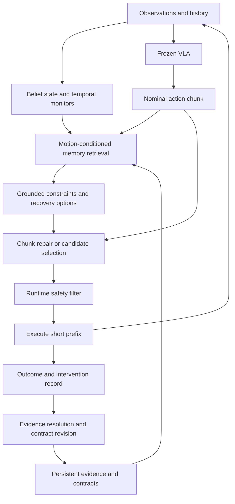

# Accumulating Safety Memory for Vision-Language-Action Policies

For the higher-risk research direction, see [Discovering What a Robot Must Remember for Safety](safety_memory_high_risk_proposal.md). That companion prioritizes discovery of new history-dependent safety representations over the conditional-contract approach below, and adds important neighboring work on predictive state, predicate invention, SOMA, and EventVLA.

## Recommendation

Build a persistent memory of **conditional safety constraints and successful interventions**, grounded in the evidence that supports them. Use relational logic to express when a constraint applies, continuous models to express the admissible motions, and episodic records to preserve observations, uncertainty, and counterexamples. Keep the VLA frozen initially so that improvements can be attributed to memory.

The strongest research question is: **Can a robot accumulate transferable safety knowledge from incomplete intervention feedback, while learning the exceptions that prevent unnecessary restrictions?** A safety filter hides the outcomes of actions it blocks. Treating every blocked action as a confirmed failure produces self-reinforcing prohibitions; treating the resulting successful rollout as evidence that the original action was safe produces the opposite error. This missing-outcome problem gives the memory mechanism a specific statistical and experimental purpose.

A working paper title is *Learning What Not to Repeat: Persistent Safety Memory from Interventions for Vision-Language-Action Policies*. A more technical title is *Learning Conditional Safety Contracts from Censored Robot Experience*. Here, a contract is a structured pair of applicability conditions and required behavior, accompanied by its evidence and validity limits. The term does not imply that a learned contract has been formally proved correct.

This recommendation is an analytical synthesis, not an established result. Literature available through September 14, 2026 already covers safety memory, temporal logic guardrails, online safety updates, and constraints inside VLA action generation. The plausible contribution is a particular learning problem and solution: learning revisable relational safety boundaries from selectively observed outcomes, retrieving them according to the proposed motion, and demonstrating continual improvement in closed-loop manipulation. A universal first-of-its-kind claim is not justified.

## Literature Map

### The closest safety-memory work

| Work | Established mechanism | Implication for this project |
|---|---|---|
| Du, Zhao, and An, *Learning Safe Robot Planning from Unsafe Experiences* (2026 OpenReview manuscript) | Stores unsafe commands with scene and harm information; consolidates episodes into semantic rules; retrieves to block commands and prompt alternatives. | Explicit episodic plus semantic safety memory is already prior art. Continuous action constraints, incomplete intervention evidence, and controlled transfer experiments must distinguish a new method.[^1] |
| *Embodied Safety Alignment: Combining RLAF and Rule-Based Memory for Trustworthy Robots* (anonymous OpenReview manuscript) | Describes persistent interaction records, hierarchical safety rules, and reflective updates using VLM feedback in synthetic image-text settings. | Rule hierarchies and reflective safety-memory updates cannot be the headline novelty. The accessible description provides limited evidence about physical closed-loop control.[^2] |
| Shinde, *Safety as Compilation* (2026 draft) | Compiles structured near-miss traces into Boolean rules for a small discrete decision space. | Compiling experience into executable safety rules is also prior art. The reported setting is decision support, rather than general continuous VLA control.[^3] |
| Shinde, *Safety-Monotonic Versioned Memory* (2026 draft) | Gates rule-memory updates using regression scores and preservation of hazard-family support. | Versioning and regression-gated safety retention should be engineering components, not novelty claims. Its stated escalation-only formulation cannot repair an overly conservative baseline.[^4] |
| Santos et al., *Updating Robot Safety Representations Online from Natural Language Feedback* (ICRA 2025) | Uses visual observations and language feedback to update safety constraints and warm-start an HJ reachability controller. | Online semantic safety updates connected to formal control already exist. A new method should learn generalizable conditions from accumulated evidence, beyond updating an environment-specific failure set.[^5] |
| Agrawal et al., *AnySafe* (ICRA 2026) | Conditions a latent safety filter on a constraint image; learns failure-relevant similarity and calibrates the failure set. | A visual memory that conditions a safety controller is a strong alternative and a close control baseline. Its scope and training assumptions matter when claiming transfer to previously unseen hazards.[^6] |

Evidence maturity varies considerably. The first paper's indexed PDF uses an ICLR 2026 conference header, but its precise archival venue status is not independently established here; treat it as an OpenReview manuscript rather than assuming a main-conference acceptance. The anonymous manuscript and the two Shinde drafts are relevant to idea precedence, without being equivalent evidence of physical robot performance. Numerical results across these papers should not be placed in a common leaderboard.

### Memory in robot policies

**MemoryVLA** maintains perceptual and cognitive memory, retrieves context, merges redundant entries, and conditions a diffusion action expert on the result. This establishes a strong architecture for historical context within manipulation. Its evaluations do not by themselves establish persistent accumulation of safety constraints across an evolving sequence of deployments.[^7]

**MemoryVLA++** adds imagined future states, so a combination of memory and a world model is already occupied territory. **ReMem-VLA** instead uses recurrent queries at frame and chunk timescales, providing a useful comparison against an explicit retrievable store. Both are relevant when earlier observations determine what an action means now.[^8][^9]

**HALO** learns sparse retrieval over previous observations, proprioception, and actions, using VLM supervision to discourage spurious historical correlations. Its relevance is methodological: a history model can retrieve distracting details even when it has sufficient capacity. A safety retriever should therefore be evaluated on whether it selects the evidence needed for the current decision.[^10]

**ChemBot** connects persistent episodic retrieval and working scene memory to a hierarchical VLA executor in chemical laboratory tasks. It prevents a broad novelty claim about long-term memory guiding a VLA in a safety-relevant domain. Its described long-term store emphasizes historical dialogue, experimental archives, and operational experience.[^11]

**Retrieval-Augmented Embodied Agents** retrieves policies from a memory bank for manipulation. It is useful precedent for procedural memory, but storing a successful motion does not establish that the motion is safe after changes in geometry, payload, or controller.[^12]

The design distinction is between memory of current world state, experience reusable across episodes, and knowledge distilled into model parameters. A method can support one without supporting the others. The proposed work should explicitly evaluate persistent experience accumulation rather than equating a long context window with lifelong learning.

### Learning constraints and handling feedback

**Learning Shared Safety Constraints from Multi-task Demonstrations** addresses the ambiguity of learning what is forbidden from expert behavior. Diverse tasks help separate safety restrictions from task-specific preferences. This is directly relevant to avoiding rules that prohibit everything the robot has not yet done.[^13]

**Uncertainty-Aware Constraint Learning for Adaptive Safe Motion Planning from Demonstrations** maintains uncertainty over inferred constraints and plans accordingly. Thus, uncertainty over learned safety rules and acting to resolve it are established ideas.[^14]

**Learning Constraints on Autonomous Behavior from Proactive Feedback** models interventions that anticipate future violations. It shows why interpreting a proactive intervention as a label on the current state can misidentify the constraint. Its train-then-deploy formulation is a particularly important neighbor for a persistent deployment-learning proposal.[^15]

The **selective labels** literature studies outcomes observed only when earlier decisions permit them. A robot safety filter creates a related problem: the nominal action's outcome is missing precisely in cases the filter finds concerning. Applying this connection to persistent VLA safety memory is a research direction; the statistical issue itself is established.[^16]

**Recovery RL** separates task execution and recovery policies and learns from offline safety data. **Learning Barrier Functions with Memory for Robust Safe Navigation** incrementally learns signed distance approximations using replay memory and incorporates approximation uncertainty into control. Learned recovery and replay-based barrier learning are therefore ingredients to build on.[^17][^18]

### Logic and VLA guidance

| Approach | What it establishes | What memory would add |
|---|---|---|
| Safety Chip; RoboGuard | Natural language and contextual rules can become temporal constraints for checking or repairing symbolic plans.[^19][^20] | Learn and revise the conditions from experience; ground their consequences in continuous manipulation. |
| Safe reinforcement learning via shielding | A monitor can constrain actions relative to a formal specification and an environment model.[^21] | Discovering a correct specification is a separate problem. |
| Learning Linear Temporal Properties; Reward Machines | Temporal structure can be learned from examples or represented by explicit finite-state machinery.[^22][^23] | Associate learned history-dependent hazards with evidence and grounded control requirements. |
| VLSA/AEGIS | A CBF safety layer can wrap VLA actions; SafeLIBERO provides obstacle-interference tasks.[^24] | Accumulate knowledge beyond the current scene's obstacle assignment. |
| Attention-guided safety filtering | VLA attention and tracking can update target-versus-obstacle assignments online.[^25] | Learn hazards that cannot be resolved by identifying task-irrelevant objects. |
| PACS | Path-consistent braking with reachability checks addresses disruption caused by action correction.[^26] | Remember which correction or recovery remains appropriate in a new context. |
| Neuro-Symbolic Safety Guidance via Constrained Flow Matching | Corrections can enter the iterative generation of a VLA action chunk.[^27] | Supply learned, context-dependent constraints to that existing guidance mechanism. |
| SafeVLA; SafeDojo | Constrained policy learning can optimize task performance and safety, including using world-model rollouts.[^28][^29] | Compare fast external-memory adaptation against parameter updates under matched experience budgets. |

**REFLECT** summarizes multisensory robot experience to diagnose failures and guide correction. **Reflexion** uses verbal feedback in memory to improve subsequent attempts. These motivate a strong textual-memory baseline. **Yell At Your Robot** establishes language correction and iterative learning of a high-level policy, while **ViFailback** studies visual symbols for manipulation failure diagnosis and correction. Language and visual guidance should be tested as concrete interfaces, rather than assumed to work on any pretrained VLA.[^30][^31][^32][^33]

## Memory Representation

### Four linked stores

| Store | Contents | Lifetime and purpose |
|---|---|---|
| Belief state | Object identity hypotheses, poses, physical-state estimates, timestamps, and temporal-monitor states. | Tracks what is currently believed. Some facts survive episodes, with explicit validity and refresh conditions. |
| Episode evidence | Observation windows, proposed and executed actions, interventions, measured outcomes, alternative trials, and provenance. | Preserves what happened and what remains unknown. Supports later revision. |
| Safety contracts | Relational applicability conditions, forbidden outcomes or required motion conditions, parameter uncertainty, and exceptions. | Transfers knowledge between objects and tasks. |
| Recovery procedures | Successful corrective strategies, initiation conditions, termination conditions, and controller or embodiment requirements. | Helps complete the task after detecting risk. |

Use a hybrid of these stores. Pure language offers flexibility but weak grounding; embeddings retrieve perceptual analogies but can miss a safety-critical property; pure logic needs a sufficiently complete predicate vocabulary; a purely learned risk model requires data and may forget or miscalibrate. Logic is most useful as the interface for applicability and composition, with numerical models handling geometry and dynamics.

### What an episode must preserve

An event should include a short history, not just the frame at the time of failure. Store the nominal action chunk and the actually executed chunk separately. Preserve the safety filter's identity and version, because its behavior determines which outcomes are observed.

```json
{
  "event_id": "episode_014_event_003",
  "task": "move the container to the shelf",
  "roles": {
    "held_object": "track_17",
    "protected_object": "track_04"
  },
  "observation_window_ref": "episodes/014/window_003",
  "belief_snapshot_ref": "episodes/014/belief_003",
  "nominal_chunk_ref": "episodes/014/nominal_003",
  "executed_chunk_ref": "episodes/014/executed_003",
  "intervention": {
    "source": "runtime_filter",
    "version": "filter_v1",
    "reason": "predicted carried-object contact"
  },
  "nominal_outcome": {
    "observed": false,
    "harm": null
  },
  "executed_outcome": {
    "observed": true,
    "harm": false,
    "measurement_source": "independent_contact_monitor",
    "observation_horizon_steps": 20
  },
  "alternative_trials": [],
  "status": "unresolved_intervention"
}
```

An intervention is evidence that the supervisor objected, not proof of harm. A near miss requires an operational definition, such as measured minimum clearance or a validated predicted contact. A rollout with no detected harm supplies evidence only over the observed horizon and measured harm channels. These distinctions prevent memory from silently converting suspicion into ground truth.

### What a contract should encode

Define a contract as:

\[
\kappa=(\text{roles},\psi,\phi,\Theta,\mathcal{D},\mathcal{E}^{+},\mathcal{E}^{-},\mathcal{E}^{?},\mathcal{R},v).
\]

Here, \(\psi\) is the applicability condition; \(\phi\) is the required behavior; \(\Theta\) contains numerical parameters and uncertainty; \(\mathcal{D}\) specifies the validity domain; the evidence sets hold supporting, contradicting, and unresolved events; \(\mathcal{R}\) contains available recovery strategies; and \(v\) is a version. Store grounding confidence separately from confidence in the rule itself.

For example, a contract can say: during transport, if the robot holds an open liquid container, bound its tilt and acceleration; if a verified receiving vessel is beneath it and the task is pouring, switch to a different constraint mode. This provides an explicit exception without deleting the broader spill-prevention knowledge. The numerical safe envelope would need to be learned or supplied for the relevant container and fill range.

The logical skeleton is:

\[
\forall x:\quad
\mathbf{G}\big[(\operatorname{Held}(x)\land\operatorname{Open}(x)
\land\operatorname{ContainsLiquid}(x)\land\operatorname{TransportMode})
\Rightarrow (|\operatorname{tilt}(x)|\leq\theta_{\max}
\land\|\operatorname{accel}(x)\|\leq a_{\max})\big].
\]

This is a schematic relational temporal specification, not syntax accepted by the current repository parser. Quantification should instantiate a template over the currently tracked objects; a temporal monitor should maintain mode and history; numerical bounds should be enforced by a controller whose dynamics support them. Arbitrary first-order temporal formulas cannot automatically be turned into CBFs.

Represent unobserved predicates explicitly. If liquid content or lid closure is unknown, do not interpret absence of evidence as `false`. Maintain a set of plausible states or calibrated probabilities, then either choose behavior valid across that set or obtain the missing observation. Do not multiply marginal predicate confidences unless their dependence has been addressed.

### The memory unit with the greatest research value

The most useful record may be a **contrast between similar situations that require different safety decisions**. Examples include carrying a tall object versus moving with an empty gripper; transporting an open container versus pouring into a verified receiver; or handling an object before and after it has been heated. These contrasts teach the boundary of a rule.

Preserve both directions of generalization. A rule should transfer across changes in object appearance when the mechanism is unchanged, while distinguishing visually similar states when the mechanism changes. Store the physical role and relative configuration, along with the images. Scene-level visual similarity alone is an inadequate definition of safety relevance.

## Learning and Consolidation

### Start with a bounded hypothesis language

The first implementation should learn which combinations of supported predicates activate an existing constraint family. Candidate predicates can include held-object geometry, task mode, swept-volume intersection, support, proximity, and observable state transitions. Use bounded rule depth and a small set of verified numerical templates.

An LLM can propose hypotheses and useful contrasts. A deterministic parser checks syntax and types; a constraint learner or enumerative search chooses among candidates using measured evidence. Parameters such as speed limits or clearances can be fitted separately. Introduce a genuinely new predicate only when there is a detector or measurement procedure and an evaluation for it.

For a candidate \(\kappa\), one practical objective is:

\[
L(\kappa)=
\lambda_{\mathrm{miss}}L_{\mathrm{missed\ harm}}
+\lambda_{\mathrm{block}}L_{\mathrm{unnecessary\ restriction}}
+\lambda_{\mathrm{size}}\operatorname{complexity}(\kappa).
\]

This is a fitting objective, not the definition of runtime safety. Unresolved interventions must not enter either supervised outcome loss as confirmed labels. Keep a small set of plausible hypotheses when the data do not identify a unique boundary.

### Learning from blocked actions

Let \(A_t^0\) denote the nominal action chunk and \(A_t^e\) the executed chunk. The physical outcome is observed under \(A_t^e\). When they differ, the harm that would have occurred under \(A_t^0\) remains unknown unless another evidence source resolves it. A hypothetical history generated by an LLM does not resolve that uncertainty.

Use three evidence paths, with distinct labels:

1. **Observed execution:** record measured outcomes for actions actually executed, including delayed consequences and the horizon of observation.
2. **Simulator branch:** restore a saved pre-intervention state and evaluate the nominal and corrected behavior. Match relevant random factors when comparing alternatives. This establishes evidence within the simulator, with its own assumptions.
3. **Model or human assessment:** store predicted consequences or semantic feedback with the assessor's provenance and confidence. Such evidence can propose a contract or justify caution without becoming a measured physical outcome.

In the first study, simulator branches offer a feasible way to resolve selected missing outcomes. Grant identical branch-query budgets to competing methods. Otherwise an apparent memory improvement could simply reflect access to more labeled experience.

The selection of branches should target disagreement: choose contexts where plausible contracts would permit different actions, especially where a useful action is blocked by one hypothesis but permitted by another. Include benign negative controls. Repeatedly replaying only obvious failures cannot identify an overly broad rule.

There is a fundamental identifiability limit. If a deterministic supervisor always blocks a class of actions, and there is no applicable dynamics model, independent feedback, or other source of outcomes, their harm rate cannot generally be learned from those logs alone. Inverse-propensity weighting cannot solve a region with zero probability of execution. A credible paper should state what additional information makes learning possible.[^15][^16]

### A concrete first algorithm

Maintain a weighted set of candidate contracts drawn from the bounded grammar. Initially, broad semantic priors can propose candidates, but their weights must not be presented as calibrated safety probabilities. Each measured execution updates the candidate likelihoods using the action that was actually executed. Unresolved nominal outcomes contribute no fabricated harm label; separately modeled human feedback may update beliefs about applicability.

For each available simulator query, score the disagreement between candidates on that query, multiplied by the expected frequency and consequence of the affected decision, and divided by query cost. Include a fixed random-query fraction to expose blind spots in this acquisition rule. Query both potentially missed hazards and potentially unnecessary restrictions. A baseline that uses disagreement alone is needed to determine whether weighting by downstream decision relevance helps.

```text
for each encounter:
    record observation history, nominal action, and executed action
    update evidence using measured outcomes of executed behavior
    retain blocked nominal outcomes as unresolved
    instantiate applicable candidate contracts in the current scene
    select or repair the next chunk under supported constraints

at each consolidation boundary:
    propose bounded rule refinements and possible exceptions
    spend the fixed branch budget on decision-relevant disagreements
    update candidates using source-tagged branch outcomes
    evaluate the proposed contract set on prior hazards and safe contrasts
    promote the revision only if its acceptance criteria pass
```

With reliable deterministic labels, a version-space learner can eliminate hypotheses inconsistent with the data. With stochastic dynamics or noisy labels, use likelihood-based updates and retain uncertainty; a single successful execution does not falsify a probabilistic hazard. Keep simulator evidence distinguishable from physical evidence when estimating deployment confidence. This makes the learnable component specific enough to implement and ablate without claiming a new general-purpose rule-induction algorithm.

### Causal scope and exceptions

Do not label an explanation causal merely because it sounds plausible. Compare interventions that change one relevant factor while keeping others controlled where feasible: remove the payload, rotate the held object, change the clearance, or switch a verified task mode. A successful alternative action establishes a local contrast; it does not alone prove a universal physical rule.

Maintain an explicit support domain, including object geometry, payload range, observation quality, action horizon, controller, and environment conditions. A contract can initially apply narrowly to one object instance, then generalize to a class only after evidence supports the extension. Persistent instance knowledge can still be valuable before such generalization is justified.

Conflict resolution should separate several cases. New evidence may reveal a perception error, an overly broad precondition, a changed physical state, or a genuinely changed environment. These call for different updates. For example, a cooled object should update its state belief; a newly discovered insulated handle should refine the contact-region rule; neither requires discarding the history that contact with the hot body was unsafe.

### Retention without permanent overconstraint

Version the evidence and contracts. Before promoting an update, replay a fixed hazard suite and a suite of safe counterexamples. Check coverage by hazard family, unnecessary restrictions, and task success. Preserve links to the evidence behind any rule that is narrowed or retired. This follows established versioned safety-memory ideas, with the additional requirement that experience can correct overconservatism.[^4]

Under a bounded storage budget, reserve capacity for rare severe events, boundary cases, unresolved disagreements, and representative successful recoveries. Compress redundant visual windows only after preserving their evidence relationships. Separate archival storage from a smaller active retrieval index. Avoid defining importance solely by recency or frequency of retrieval, since rare hazards may be precisely the ones worth retaining.

## Storage and Retrieval

### Storage design

Begin with ordinary structured storage: a relational database for events, object identities, contracts, evidence links, and versions; chunked trajectory files for observations and actions; and an embedding index for candidate episode retrieval. A graph database is optional. The essential feature is the ability to traverse `supports`, `contradicts`, `supersedes`, `applies_to`, and `recovered_by` relationships.

Use a typed contract schema with explicit units, coordinate frames, validity conditions, and supported enforcement types. Keep scene-local track IDs separate from persistent entity IDs. A remembered hazard must not be rebound to a different object merely because its visual appearance or simulator name is similar.

Within an episode, update dynamic state estimates and monitor states at the appropriate cadence. Across episodes, retain learned contracts and validated instance properties; invalidate scene geometry and dynamic properties when their assumptions no longer hold. Cooling, contamination, battery state, and object placement require different persistence models.

### Query the proposed action

A retrieval query should include:

\[
q_t=(b_t,\text{task mode},\text{object roles},A_t^0,
\text{predicted motion features},\text{missing observations}).
\]

The nominal action matters because the same scene can be safe for one motion and unsafe for another. Include swept-volume proximity, held-object orientation, contact region, predicted acceleration, and the temporal obligations currently active. Use a short-horizon model with declared error bounds or empirical validation; a generic VLM prediction is not a calibrated dynamics model.

Retrieve in stages:

1. Resolve entity and role matches, relevant constraint families, and active temporal obligations.
2. Retrieve episodes using relational and physical features together with visual and language embeddings.
3. Fetch supporting evidence, exceptions, and contradictory cases for the candidate contracts.
4. Re-evaluate applicability against the current belief state and proposed chunk.
5. Return a small set of instantiated constraints, recovery options, and specific unresolved observations.

For a small contract library, evaluate all supported contracts. An approximate top-k embedding search should not decide which mandatory rule exists. Retrieval can limit supporting evidence and expensive hypothesis evaluation; an exhaustive or indexed guard evaluation can cover the active constraint set.

### Retrieval objective

A safety retriever should optimize the downstream decision. A useful training target is whether a retrieved contract exposes a violation in the proposed chunk or identifies an unnecessary restriction. A second target is whether retrieved evidence changes an uncertain contract's applicability. This is stronger than retrieving an episode with the same task description.

Compare a hand-designed relational retriever with a learned motion-conditioned retriever trained on these outcomes. Use hard negatives: similar scenes with different safe actions, and different scenes with the same hazard mechanism. Include shuffled or irrelevant memory controls and measure hazard recall under a fixed retrieval budget.

Memories should also guide sensing. If action permissibility depends on lid closure, object identity, or a previously observed state transition, request that specific evidence. Information gathering has a physical cost and must itself be feasible and safe. This is a possible extension after the main memory-learning result, not a prerequisite for the first implementation.

## Guiding the VLA

### Recommended first architecture



Use memory at two control timescales. At action-chunk boundaries, instantiate constraints and repair or select a trajectory that makes task progress. During execution, apply the runtime filter to the short prefix using fresh state estimates. Keep a feasible backup behavior where the controller supports one. A zero action is not automatically a safe backup in every physical state.

A conceptual chunk-repair problem is:

\[
A^*=\arg\min_A
\|A-A^0\|_W^2+\lambda_{\mathrm{smooth}}\|DA\|^2
+\lambda_{\mathrm{task}}L_{\mathrm{progress}}(A)
\quad\text{subject to}\quad
\underline{\rho}_{\phi_j}(b_t,A)\geq0\quad \forall j\in\mathcal K_t,
\]

with dynamics, actuator limits, and applicable backup-feasibility conditions. Here \(\underline{\rho}\) is a lower bound on constraint satisfaction over modeled uncertainty, not simply a raw neural score. If no reliable bound is available, the optimization is an empirical guidance method and should be described that way.

For supported instantaneous constraints, the existing CBF-QP can implement the fast layer. Constraints involving acceleration, force, thermal exposure, or history may need additional state, higher-relative-degree treatment, or a different controller. A signed distance or a temporal-logic robustness function does not automatically qualify as a control barrier function.

### Choice of guidance interface

| Interface | Advantages | Limitations | Recommendation |
|---|---|---|---|
| Short textual memory in the task prompt | Simple; tests whether explicit reminders help. | Numeric limits and negation may be ignored; a changed prompt can alter task interpretation. | Required baseline. |
| High-level subgoal or recovery selection | Can change an unsafe approach into an available safe skill. | Requires the low-level policy to support the selected skill. | Use for discrete mode transitions and recoveries. |
| Chunk repair plus runtime filter | Explicitly changes motion; works with a frozen policy. | Depends on dynamics and grounding; excessive corrections can disrupt execution. | Main first implementation. |
| Constraint guidance during flow or diffusion generation | Lets later generation steps react to corrections. | Requires model access and a compatible generative head; already prior art. | Extension for pi0.5, with an existing guidance method as the base.[^27] |
| Learned memory tokens or adapter | Can teach the VLA to anticipate constraints and reduce corrections. | Requires training, conditioning examples, and forgetting evaluation. | Later experiment after external memory works. |
| Memory-conditioned latent safety value | Can represent hazards that resist simple symbolic geometry. | Data-intensive; transfer and calibration are difficult. | Main alternative, motivated by AnySafe.[^6] |

For a deterministic OpenVLA-OFT configuration, repeated calls with the same input do not create diverse candidates. Generate candidates through explicit trajectory repair, supported subgoals, or a separately trained proposal mechanism. For a stochastic action head, candidate sampling is possible, but candidate safety still needs evaluation.

After a substantial correction, invalidate the remaining nominal chunk and replan from the observed state. A stored recovery should include conditions under which it worked, not an action sequence replayed blindly. Retarget object-relative waypoints and verify them before use. Never retrieve the old correction vector as if it were coordinate- and embodiment-independent.

A frozen backbone plus a memory-guided controller can learn at the system level even though the backbone weights do not change. Report this distinction explicitly. Later distillation can train a memory-conditioned adapter on successful corrected trajectories, but a reduction in interventions should be accompanied by stable or improved independently measured safety.

## Experimental Design

### A benchmark that requires memory

SafeLIBERO is useful for testing geometric integration and controller compatibility, but static obstacle interference alone cannot demonstrate the intended persistent-memory capability.[^24] Add a longitudinal task stream with observable histories, new instances, and revisits after unrelated tasks.

| Hazard family | What must be remembered | Contrast needed for a convincing test |
|---|---|---|
| Carried-object contact | The held object's shape and a learned clearance or orientation condition. | Empty gripper versus tall or wide payload; transfer across shapes and tasks. |
| Object-specific handling limit | Evidence that a particular object needs a lower acceleration or contact-force envelope. | Same appearance with different measured properties; a new instance outside the validated range. |
| Persistent hidden state | An earlier heating, wetting, contamination, or lock-state event. | Identical current images with different prior histories and different appropriate actions. |
| Mode-dependent safety | The condition distinguishing transport from authorized pouring, opening, or contact. | A safe exception that an unconditional rule would wrongly block. |
| Changed environment | A remembered property has changed and new evidence reveals it. | Correct revision after change without forgetting unaffected hazards. |

Start with carried-object geometry and an object-state or task-mode family that can be instrumented reliably. Do not claim spill or thermal safety if the simulator only checks collisions. A symbolic thermal or contamination state is acceptable for a clearly labeled semantic-memory experiment, but it does not validate physical heat or fluid dynamics.

Construct observationally ambiguous cases deliberately. If a supposedly hidden property has no observable cue in either current or past inputs and no feedback channel, no method can infer it reliably. Conversely, avoid simulator object names or task IDs that directly reveal the hazard label.

### Two complementary evaluations

**Shared experience:** give every method the same ordered evidence stream, simulator branch budget, perception outputs, and controller. Compare memory representation and retrieval using frozen test checkpoints. This isolates the contribution of memory organization and learning.

**Interactive accumulation:** let each method act and accumulate its own experience. Evaluate the resulting learning curves under equal budgets. Because methods visit different states, this measures the complete system and should not be interpreted as isolating the retriever alone.

At each milestone, freeze a copy of the memory and evaluate on unseen probe episodes without writes. The training stream may revisit tasks, but test probes must not be fed back into later memory updates. Randomize task order across independent streams. Treat the stream or appropriate task cluster as the statistical unit, rather than individual control steps.

### Essential comparisons

1. Frozen VLA with the existing memoryless safety filter.
2. The same system with within-episode history only.
3. Textual episode retrieval and reflection, using the same evidence.
4. Episodic-to-semantic safety rules without explicit missing-outcome handling, adapted from the closest safety-memory design.
5. A learned continuous risk model or latent safety memory using the same feedback budget.
6. The proposed relational contracts, outcome provenance, counterexamples, and motion-conditioned retrieval.
7. An oracle contract and state variant, labeled as a ceiling rather than a deployable competitor.

Keep the same control backend when comparing memories. Separately compare prompt guidance, chunk repair, and generative guidance while holding memory fixed. Otherwise better control may be mistaken for better memory. Published results on different policies, task suites, or sensing privileges are contextual evidence, not matched baselines.

### Metrics and ablations

Primary outcomes should include cumulative measured harm, safe task success, repeat-hazard failure rate after first exposure, and retention on earlier hazard families. Report acquisition curves, transfer to unseen instances and tasks, unnecessary intervention rate on safe contrasts, completion time, and sensing or human-help cost.

For the memory mechanism, measure applicable-contract recall, exception accuracy, retrieval latency, storage size, and unresolved-outcome frequency. Measure missed severe events separately from average performance. Report safety and useful task completion jointly; an always-stop system is an informative degenerate baseline.

The decisive ablations are: treat every intervention as failure; discard blocked actions; omit successful counterexamples; retrieve by scene alone; remove task-mode conditions; remove persistence across episodes; use the same number of random simulator queries; and keep a larger uncompressed episode store. These isolate whether the proposed learning mechanism improves on simpler explanations.

Use independently checked outcome instrumentation. The repository's `docs/code_review_findings.md` documents contact-measurement defects and vacuous affordance metrics in earlier LIBERO-Safety paths. Validate the exact runner and scorer used for the new study using injected contacts, terminal-step violations, multiple constraints, and known safe controls. Historical reported collision columns are not sufficient evidence for the new memory learner.

### What would make the result publishable

A strong result would show that after a small number of informative encounters, the system prevents a recurring hazard in new tasks, retains that knowledge after unrelated experience, and permits safe exceptions that simpler memory systems block. It would also show that these gains persist with imperfect visual grounding and are not explained by extra simulator queries or a stronger controller.

The central hypothesis should be rejected or narrowed if text retrieval matches the method under matched budgets, the advantage disappears on new instances, memory only helps with oracle state, or improvements arise through increasing refusal. These outcomes would favor a simpler system or a paper about the limits of safety-memory learning.

## Theory and Novelty

Three tractable theoretical targets are available. First, formalize the non-identifiability caused by deterministic intervention and show which additional observations resolve it in a bounded hypothesis class. Second, establish what a counterexample update preserves on a specified set of earlier cases. Third, compose retrieval and perception coverage with a controller's conditional guarantee.

For the third target, define failure events for missing a relevant contract, incorrect grounding, incorrect learned specification, and failure of control assumptions. If safety follows whenever none occur, a union bound gives:

\[
P(\text{violation over a specified horizon})
\leq \epsilon_{\mathrm{retrieval}}+\epsilon_{\mathrm{grounding}}
+\epsilon_{\mathrm{specification}}+\epsilon_{\mathrm{control}}.
\]

This decomposition is an analytical target, not a guarantee supplied by the proposed architecture. Each term needs a defensible bound under the actual deployment distribution. Unknown hazards are part of specification coverage, and cannot disappear from the bound by definition. Per-step claims need horizon accounting; independence is not required for a union bound.

Conformal methods offer useful calibration tools, as demonstrated by KnowNo and AnySafe, but exchangeability and selection matter. Adaptive retrieval, changing memory versions, and policy-dependent observations can invalidate a naive use of a calibration set. Calibrate the deployed selection-and-control pipeline on separated data and label OOD performance empirically unless stronger assumptions are established.[^6][^34]

Likewise, satisfying every stored constraint can create an empty feasible action set. Updating a constraint while the robot is already outside its safe set does not establish forward invariance retroactively. The update procedure must check feasibility and recovery assumptions as well as logical consistency.

The novelty claim should therefore be narrow: **persistent learning of conditional safety boundaries from selectively observed robot experience, with explicit correction of overgeneralization and executable guidance for continuous VLA actions**. The contract schema, rule induction, retrieval, and controller are individually familiar. The paper needs a clear algorithmic contribution in learning from missing outcomes or selecting informative contrasts, plus evidence that it improves cumulative safety at useful task success.

## Fit to the Current Repository

The current pipeline is a good starting point. `FOLSafetyFilter.setup_episode()` clears the knowledge base, and `FOLRule` already connects formulas, object bindings, CBF types, and response actions. That provides a place to instantiate persistent templates into scene-local rules. The present rule dataclass does not express the proposed evidence sets, validity domains, versioning, or temporal monitor state.

Do not simply retain all bound rules across resets. Their object bindings and geometry can become stale. Introduce persistent unbound templates, then re-ground them against each episode's observations. Preserve state across episodes only when entity identity and persistence assumptions support it.

The heuristic property grounder currently infers some physical properties from names, such as treating container-like names as full. Such assumptions may be useful defaults but are not observed physical facts. The memory experiment needs source-tagged beliefs and test cases that expose incorrect priors, or it risks accumulating repeated guesses as knowledge.

Suggested stages:

1. **Instrument evidence.** Log nominal and executed chunks, observed outcome horizons, filter reasons, and simulator snapshot references. Establish a small shared-evidence dataset and reliable independent harm measurements.
2. **Demonstrate accumulation.** Add a persistent evidence store, a bounded contract learner, all-contract evaluation, and two hazard families. Run memoryless, textual, and naive-rule baselines with identical controller and query budgets.
3. **Test the research mechanism.** Add disagreement-selected counterfactual branches, contract exceptions, and motion-conditioned retrieval. Measure transfer, retention, false restriction, and perception sensitivity.
4. **Expand guidance only after the memory result.** Connect memory to pi0.5 generation or train a small adapter. Compare against the frozen external-controller version to determine whether direct policy conditioning adds value.

The recommended first paper should center on stages 1-3. Full open-vocabulary predicate invention, learned world models, arbitrary temporal synthesis, and policy distillation each add a separate research problem. They are extensions, not necessary ingredients for demonstrating accumulated safety.

## Sources

Numbered references link to original papers, author manuscripts, or official project material. Dates distinguish initial preprints from verified later venues where available. The OpenReview manuscripts and independent drafts have limited publication-status verification; they are included as relevant prior disclosures. The literature synthesis relies on accessible abstracts and method text, with full-text inspection for the principal architecture and control comparisons; it is not a reproduction of their experiments.

[^1]: Jing Du, Hang Zhao, and Shengwei An. [Learning Safe Robot Planning from Unsafe Experiences: An Episodic Memory Approach for LLM-based Agents](https://openreview.net/pdf/ab5abed17352d3c1bd4ad7e045305e31836deb3e.pdf). OpenReview manuscript, 2026. Indexed abstract and method text accessible; direct PDF access encountered browser verification. Venue status not independently established.
[^2]: Anonymous authors. [Embodied Safety Alignment: Combining RLAF and Rule-Based Memory for Trustworthy Robots](https://openreview.net/pdf/a980d48be1a4b20ecf04d38943460fd13bf38278.pdf). OpenReview manuscript, indexed 2025. Exact publication date and acceptance status unverified; indexed abstract and introductory method description accessible.
[^3]: Saish Shinde. [Safety as Compilation: Deterministic Near-Miss Memory for Edge Robot Decision Support](https://www.researchgate.net/publication/404754739_Safety_as_Compilation_Deterministic_Near-Miss_Memory_for_Edge_Robot_Decision_Support). Author draft, 2026; indexed May 2026. Publication status unverified.
[^4]: Saish Shinde. [Safety-Monotonic Versioned Memory: Regression-Gated Updates for Robot Safety Rules](https://www.researchgate.net/publication/405669898_Safety-Monotonic_Versioned_Memory_Regression-Gated_Updates_for_Robot_Safety_Rules). Author draft, 2026; indexed June 2026. Publication status unverified. Method and limitations describe discrete escalation-only updates.
[^5]: Leonardo Santos, Zirui Li, Lasse Peters, Somil Bansal, and Andrea Bajcsy. [Updating Robot Safety Representations Online from Natural Language Feedback](https://arxiv.org/abs/2409.14580). September 2024 preprint; ICRA 2025. [Method text](https://arxiv.org/html/2409.14580v1).
[^6]: Sankalp Agrawal, Junwon Seo, Kensuke Nakamura, Ran Tian, and Andrea Bajcsy. [AnySafe: Adapting Latent Safety Filters at Runtime via Safety Constraint Parameterization in the Latent Space](https://arxiv.org/abs/2509.19555). September 2025 preprint; ICRA 2026 per the [official project page](https://any-safe.github.io/). [Method and limitations](https://arxiv.org/html/2509.19555v1).
[^7]: Hao Shi et al. [MemoryVLA: Perceptual-Cognitive Memory in Vision-Language-Action Models for Robotic Manipulation](https://arxiv.org/abs/2508.19236). August 2025 preprint; ICLR 2026. [Method text](https://arxiv.org/html/2508.19236v1).
[^8]: Hao Shi et al. [MemoryVLA++: Temporal Modeling via Memory and Imagination in Vision-Language-Action Models](https://arxiv.org/abs/2606.09827). June 2026 preprint.
[^9]: Hang Li et al. [ReMem-VLA: Empowering Vision-Language-Action Model with Memory via Dual-Level Recurrent Queries](https://arxiv.org/abs/2603.12942). March 2026 preprint.
[^10]: Rutav Shah, Yisu Li, Femi Bello, Yuke Zhu, and Roberto Martin-Martin. [Memory Retrieval in Visuomotor Policies for Long-Horizon Robot Control](https://robin-lab.cs.utexas.edu/HALO/). HALO official project page, available in 2026; exact publication date not established here.
[^11]: Xu Huang et al. [Long-Term Memory for VLA-based Agents in Open-World Task Execution](https://arxiv.org/abs/2604.15671). April 2026 preprint, revised August 3, 2026. [ChemBot method text](https://arxiv.org/html/2604.15671v2).
[^12]: Zhu et al. [Retrieval-Augmented Embodied Agents](https://openaccess.thecvf.com/content/CVPR2024/papers/Zhu_Retrieval-Augmented_Embodied_Agents_CVPR_2024_paper.pdf). CVPR 2024.
[^13]: Konwoo Kim, Gokul Swamy, Zuxin Liu, Ding Zhao, Sanjiban Choudhury, and Zhiwei Steven Wu. [Learning Shared Safety Constraints from Multi-task Demonstrations](https://arxiv.org/abs/2309.00711). September 2023 preprint.
[^14]: Glen Chou, Dmitry Berenson, and Necmiye Ozay. [Uncertainty-Aware Constraint Learning for Adaptive Safe Motion Planning from Demonstrations](https://proceedings.mlr.press/v155/chou21a.html). CoRL 2020, PMLR proceedings published 2021.
[^15]: Connor Basich, Saaduddin Mahmud, and Shlomo Zilberstein. [Learning Constraints on Autonomous Behavior from Proactive Feedback](https://doi.org/10.1109/IROS55552.2023.10341801). IROS 2023. [Accessible author-paper text](https://www.researchgate.net/publication/376503433_Learning_Constraints_on_Autonomous_Behavior_from_Proactive_Feedback).
[^16]: Himabindu Lakkaraju, Jon Kleinberg, Jure Leskovec, Jens Ludwig, and Sendhil Mullainathan. [The Selective Labels Problem: Evaluating Algorithmic Predictions in the Presence of Unobservables](https://www.cs.cornell.edu/home/kleinber/kdd17-selective.pdf). KDD 2017.
[^17]: Brijen Thananjeyan et al. [Recovery RL: Safe Reinforcement Learning with Learned Recovery Zones](https://arxiv.org/abs/2010.15920). October 2020 preprint; IEEE Robotics and Automation Letters, 2021.
[^18]: Kehan Long, Cheng Qian, Jorge Cortes, and Nikolay Atanasov. [Learning Barrier Functions with Memory for Robust Safe Navigation](https://arxiv.org/abs/2011.01899). November 2020 preprint; 2021 journal version available from the [authors](https://erl.ucsd.edu/ref/Long_LearningCBF_RAL21.pdf).
[^19]: Ziyi Yang, Shreyas S. Raman, Ankit Shah, and Stefanie Tellex. [Plug in the Safety Chip: Enforcing Constraints for LLM-driven Robot Agents](https://arxiv.org/abs/2309.09919). September 2023 preprint.
[^20]: Zachary Ravichandran, Alexander Robey, Vijay Kumar, George J. Pappas, and Hamed Hassani. [Safety Guardrails for LLM-Enabled Robots](https://arxiv.org/abs/2503.07885). March 2025 preprint, revised March 2026.
[^21]: Mohammed Alshiekh et al. [Safe Reinforcement Learning via Shielding](https://arxiv.org/abs/1708.08611). August 2017 preprint; AAAI 2018.
[^22]: Daniel Neider and Ivan Gavran. [Learning Linear Temporal Properties](https://www.cs.utexas.edu/~hunt/FMCAD/FMCAD18/papers/paper40.pdf). FMCAD 2018.
[^23]: Rodrigo Toro Icarte, Toryn Klassen, Richard Valenzano, and Sheila McIlraith. [Using Reward Machines for High-Level Task Specification and Decomposition in Reinforcement Learning](https://proceedings.mlr.press/v80/icarte18a.html). ICML 2018.
[^24]: Songqiao Hu et al. [VLSA: Vision-Language-Action Models with Plug-and-Play Safety Constraint Layer](https://arxiv.org/abs/2512.11891). December 2025 preprint. [Official code and SafeLIBERO description](https://github.com/THU-RCSCT/vlsa-aegis).
[^25]: Seongbin Park et al. [Your Model Already Knows: Attention-Guided Safety Filter for Vision-Language-Action Models](https://arxiv.org/abs/2606.09749). June 2026 preprint.
[^26]: Ralf Roemer, Julian Balletshofer, Jakob Thumm, Marco Pavone, Angela P. Schoellig, and Matthias Althoff. [From Demonstrations to Safe Deployment: Path-Consistent Safety Filtering for Diffusion Policies](https://arxiv.org/abs/2511.06385). November 2025 preprint, revised March 2026; ICRA 2026.
[^27]: William English, Hao Zheng, and Rickard Ewetz. [Neuro-Symbolic Safety Guidance for Vision-Language-Action Models via Constrained Flow Matching](https://arxiv.org/html/2607.01378v1). July 2026 preprint. Its experiments use simulator obstacle positions, which separates controller results from visual grounding.
[^28]: Borong Zhang et al. [SafeVLA: Towards Safety Alignment of Vision-Language-Action Model via Constrained Learning](https://arxiv.org/abs/2503.03480). March 2025 preprint, revised April 2026; NeurIPS 2025 Spotlight.
[^29]: Kai Tang et al. [SafeDojo: Safe Reinforcement Learning for VLA via Interactive World Model](https://arxiv.org/abs/2606.20698). June 15, 2026 preprint. [Method and training details](https://arxiv.org/html/2606.20698v1).
[^30]: Zeyi Liu, Arpit Bahety, and Shuran Song. [REFLECT: Summarizing Robot Experiences for Failure Explanation and Correction](https://proceedings.mlr.press/v229/liu23g/liu23g.pdf). CoRL 2023.
[^31]: Noah Shinn et al. [Reflexion: Language Agents with Verbal Reinforcement Learning](https://arxiv.org/abs/2303.11366). March 2023 preprint.
[^32]: Lucy Xiaoyang Shi et al. [Yell At Your Robot: Improving On-the-Fly from Language Corrections](https://arxiv.org/abs/2403.12910). March 2024 preprint.
[^33]: Xianchao Zeng et al. [Diagnose, Correct, and Learn from Manipulation Failures via Visual Symbols](https://arxiv.org/abs/2512.02787). December 2025 preprint; CVPR 2026 [official paper](https://openaccess.thecvf.com/content/CVPR2026/papers/Zeng_Diagnose_Correct_and_Learn_from_Manipulation_Failures_via_Visual_Symbols_CVPR_2026_paper.pdf).
[^34]: Allen Z. Ren et al. [Robots That Ask For Help: Uncertainty Alignment for Large Language Model Planners](https://arxiv.org/abs/2307.01928). July 2023 preprint. KnowNo.
