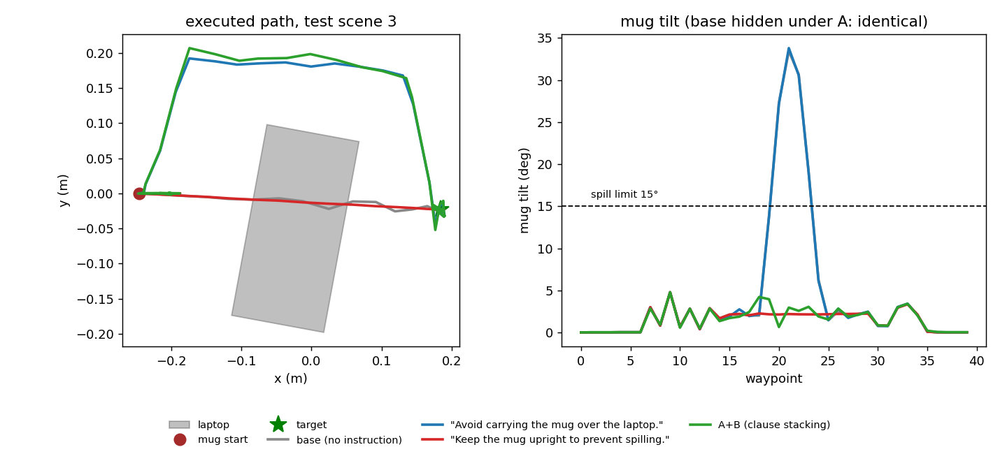

# Text-conditioned residual flow POC — results

Spec: `docs/Text_Conditioned_Residual_Flow_POC.pdf`. Design, metrics and code: `README.md`.
Run: slurm job 49099563 (GPU-small, 1×V100; 33 min: 3 models × 30k steps, then 7,700 MuJoCo rollouts).
Full tables: `results_primary.md` / `results_primary.json` (copied from `runs/eval/`).

**Evaluation protocol.** 100 test scenes from a seed stream disjoint from the 4,000 training
scenes. Model conditions use 3 flow samples per scene (Exp 1), 1 per scene per phrasing
(Exp 2), and 2 (Exp 3). Brackets are 95% Wilson CIs. Paired tests use flow sample 0,
paired by scene (exact McNemar; b = first arm better, c = second better). All metrics come
from simulated mug state after executing the corrected waypoints, not from the commands.

## Verdict

| experiment | outcome |
|---|---|
| 1. Text-conditioned action correction | **PASS, strongly.** Swapping only the instruction switches the correction between a path detour (A) and an orientation fix (B). Text is causal: no-text, shuffled-text and mean-residual baselines all fail, with paired p < 1e-16. |
| 2. Language generalization | **PASS for B; PARTIAL for A.** All 8 unseen B paraphrases work (100%). Of the 8 unseen A paraphrases, 5 work (85–98%) and 3 fail (13–24%). Pooled A: 63% vs 96% for training phrasings. |
| 3. Compositional generalization (unseen A+B sentence, fed directly) | **FAIL.** Both constraints satisfied, with task success, on 0/1,200 rollouts. The model snaps to one constraint, or to neither; it never composes. |
| *(secondary) 2 + embedding augmentation* | Post-hoc, scored on a fresh paraphrase set: held-out A 0.615 → 0.799; one phrasing is still misread as B. |
| *(secondary) 3 via clause-level residual stacking* | Inference-only, no retraining: both ok & success on **0.965 (A→B) / 0.978 (B→A)**, matching the near-trivial residual sum (0.969). The constraints compose as separate residual operators but not inside one sentence embedding. |

*Test scene 3, executed trajectories (`make_figure.py`). A text detours around the laptop and keeps the base tilt. B text keeps the straight path and removes the tilt. Clause-level A+B stacking does both.*

## Pre-training control check (`oracle_check.py`, all 100 test scenes)

| trajectory | viol A | viol B | success |
|---|---|---|---|
| base | 1.00 | 1.00 | 0.99 |
| oracle A (detour) | 0.03 | 1.00 | 0.98 |
| oracle B (upright) | 1.00 | 0.00 | 1.00 |
| oracle A+B | 0.00 | 0.00 | 1.00 |

The base trajectory violates both constraints on every test scene. Each oracle fixes only its
own constraint, and feasible corrections exist (the spec's required control). Oracle A's 3%
is a tracking-error floor: the commanded detour keeps 3 cm of clearance, and the IK servo
occasionally cuts a corner.

## Exp 1 — swap the instruction, keep scene and base fixed (training phrasings)

| condition | viol A | viol B | task success | A-ok & succ | B-ok & succ | Δpos (m) | Δrot (deg) |
|---|---|---|---|---|---|---|---|
| base (identity) | 1.00 | 1.00 | 0.99 | 0.00 | 0.00 | 0 | 0 |
| **main, A text** | **0.04** [0.02,0.06] | 1.00 | 0.99 | **0.96** | 0.00 | 0.059 | 0.0 |
| **main, B text** | 1.00 | **0.00** [0.00,0.01] | 1.00 | 0.00 | **1.00** | 0.000 | 5.6 |
| main, empty text | 1.00 | 1.00 | 0.99 | 0.00 | 0.00 | 0.000 | 0.0 |
| no-text model | 0.63 | 0.60 | 1.00 | 0.37 | 0.40 | 0.022 | 2.3 |
| shuffled-text model, A text | 0.63 | 0.59 | 1.00 | 0.37 | 0.41 | 0.022 | 2.3 |
| shuffled-text model, B text | 0.59 | 0.65 | 1.00 | 0.41 | 0.35 | 0.024 | 2.0 |
| per-instruction mean residual A | 1.00 | 1.00 | 0.99 | 0.00 | 0.00 | 0.002 | 0.0 |
| per-instruction mean residual B | 1.00 | 1.00 | 0.99 | 0.00 | 0.00 | 0.000 | 0.2 |
| oracle A / oracle B | 0.03 / 1.00 | 1.00 / 0.00 | 0.98 / 1.00 | | | 0.059 / 0 | 0 / 5.6 |

Paired tests (scene-level):

| comparison | metric | b | c | p |
|---|---|---|---|---|
| main-A vs shuffled-A | A-ok & success | 58 | 0 | 7e-18 |
| main-A vs no-text | A-ok & success | 63 | 2 | 1e-16 |
| main-A vs mean-A | A-ok & success | 96 | 0 | 3e-29 |
| main-B vs shuffled-B | B-ok & success | 65 | 0 | 5e-20 |
| main-B vs no-text | B-ok & success | 59 | 0 | 4e-18 |
| main-B vs mean-B | B-ok & success | 100 | 0 | 2e-30 |
| swap: main-A vs main-B | A-ok & success | 96 | 0 | 3e-29 |
| swap: main-B vs main-A | B-ok & success | 100 | 0 | 2e-30 |

How to read Exp 1:

- **2×2 specificity is clean.** A text moves the path (0.059 m mean correction, 0.0° rotation)
  and leaves the tilt alone. B text fixes the orientation (5.6°) and leaves the path alone
  (0.000 m). The empty instruction returns the base trajectory unchanged.
- **The A correction depends on the scene; it is not a lookup.** The detour side is set by
  geometry (+y on 59% of test scenes). The model picks the oracle's side on 93% of samples.
  The per-instruction mean residual (one correction per text string) fixes 0% of scenes
  because the two detour sides cancel in the mean. Mean-B fails for the same reason: the tilt axis, sign
  and timing are randomized, so the mean B residual is about 0.2°. Even the 'easy' constraint needs
  base-trajectory conditioning.
- **Without usable text the model hedges.** The no-text and shuffled models learned the
  marginal over {A, B, none}. Per sample they produce A-like, B-like or null corrections
  in roughly the training proportions, so they score about 60% on each constraint
  regardless of the instruction.
- Task success is not sacrificed: 0.99–1.00 across all corrected conditions.

## Exp 2 — unseen paraphrases (main model, 100 scenes per phrasing)

| held-out phrasing | max cos to train-A | max cos to train-B | target constraint ok & success |
|---|---|---|---|
| Don't pass above the electronics. *(spec)* | 0.726 | 0.659 | 0.88 [0.80,0.93] |
| Stay clear of the space above the notebook computer. | 0.755 | 0.590 | 0.85 |
| Make sure the cup never travels over the laptop. | 0.882 | 0.728 | 0.98 |
| The beverage must not be carried across the top of the computer. | 0.779 | 0.682 | 0.88 |
| Route around the keyboard rather than over it. | 0.734 | 0.636 | **0.24** |
| Liquids should never be moved over electronic devices. | 0.704 | 0.626 | **0.13** |
| Go around the laptop. | 0.813 | 0.613 | 0.90 |
| Keep the drink away from the airspace over the PC. | 0.821 | 0.750 | **0.16** |
| Maintain the cup's vertical orientation. *(spec)* | 0.659 | 0.862 | 1.00 [0.96,1.00] |
| Don't let the drink slosh out. | 0.712 | 0.773 | 1.00 |
| Keep the coffee from spilling. | 0.788 | 0.868 | 1.00 |
| The mug should stay level the whole time. | 0.735 | 0.854 | 1.00 |
| No tipping or tilting of the cup during transport. | 0.645 | 0.791 | 1.00 |
| Carry it as if it were full to the brim. | 0.561 | 0.679 | 1.00 |
| Ensure the beverage container remains upright. | 0.686 | 0.873 | 1.00 |
| Avoid rotating the mug sideways. | 0.804 | 0.882 | 1.00 |

For every held-out phrasing the off-target constraint stays violated (1.00) and task
success is 0.99–1.00. The model never over-corrects into the other constraint.

How to read Exp 2:

- **Both spec examples generalize.** "Don't pass above the electronics" scores 0.88 and
  "Maintain the cup's vertical orientation" scores 1.00.
- **The failing A phrasings produce attenuated detours, not missing ones.** Their mean
  position correction is 0.036–0.040 m, against 0.059 m for training phrasings (60–70% of
  full size). That is not enough to clear the laptop. They also leak about 1° of rotation.
  The passing phrasings reach 0.054–0.059 m.
- **Cosine similarity to the training phrasings does not predict failure.** "Airspace over
  the PC" (cos 0.821) fails, while "Don't pass above the electronics" (cos 0.726) succeeds.
  All 16 held-out phrasings are nearer their own class than the other class, so a
  nearest-neighbour classifier on BGE would get every one right. The loss happens in the
  learned text-to-residual mapping, which treats an off-manifold embedding as a partial
  "none"/"B" blend.
- **Caveat: B is a low bar.** The B residual is the negated rotation part of the base
  trajectory, which the model receives as input. A is the hard, scene-dependent
  constraint, so 100% on held-out B says less than 63% on held-out A.

## Exp 3 — unseen combined instruction (headline: the sentence fed directly)

No combined instruction and no A+B target was ever trained on.

| instruction (unseen) | viol A | viol B | both ok & success | what the model did |
|---|---|---|---|---|
| Avoid carrying the mug over the laptop and keep the mug upright to prevent spilling. | 0.76 | 1.00 | 0.00 | weak A |
| Keep the mug upright to prevent spilling, and avoid carrying it over the laptop. | 1.00 | 1.00 | 0.00 | neither (≈ half blend) |
| Don't pass above the electronics and maintain the cup's vertical orientation. | 1.00 | 0.20 | 0.00 | B only |
| Carry the mug around the laptop without tilting it. | 1.00 | 0.98 | 0.00 | neither |
| Keep the cup level and away from the space above the laptop. | 0.04 | 1.00 | 0.00 | A only |
| Do not spill, and do not go over the computer. | 0.53 | 1.00 | 0.00 | weak A |
| **pooled (1,200 rollouts)** | 0.72 | 0.86 | **0.00** [0.00,0.003] | |
| shuffled-text model, pooled | 0.65 | 0.59 | 0.00 | |
| oracle A+B | 0.00 | 0.00 | 1.00 | |

Task success stays at 1.00. The model never breaks the task, but it also never satisfies
both constraints.

**Pre-specified secondary (in `evaluate.py` before any training; ran in the same job): inference-time velocity composition.**
v = v_∅ + (v_A-clause − v_∅) + (v_B-clause − v_∅), using hand-split clauses. Pooled
both-ok & success: 0.03 [0.02,0.04]. Viol A rises to 0.86 and viol B falls to 0.29: the
B part partly survives and the detour is mostly lost. On the first combined instruction,
whose clauses are the exact training phrasings, the composed flow still loses the
detour (viol A 0.83). So this failure is in the composition operator, not in language
understanding.

**Why composition fails here.** Every A training target keeps the base tilt, and every B
target has zero detour. The conditional distributions p(ΔA | A) and p(ΔA | B) therefore
have disjoint supports. A trajectory carrying both a detour and an orientation fix is out
of distribution for both conditionals. During integration, each conditional reads x_t and
pulls it back toward its own support, so a product-of-experts style velocity sum has no
shared mass to converge to. This is a property of the data design in the spec, not only
of this model. Exp 1's specificity requirement (A must not touch orientation) is exactly
what makes naive conditional composition fail. Exp 1 and naive composition pull against
each other under this training recipe.

### Exp 3 follow-ups (declared 2026-10-13, before running; inference-only, existing `main` model, no tuning)

1. **Sequential residual stacking.** base' = base + ΔA from the A clause; then ΔB ~ p(· | s, base', B clause);
   corrected = base' + ΔB. Run in both orders (A→B, B→A). This is the informative test: the second pass
   sees a base it never trained on. In the B→A order, the A model gets a tilt-free base, and every
   training base had at least 35° of tilt.
2. **Independent-sample residual sum.** ΔA_sample + ΔB_sample, drawn from the same scene. A and B act on
   disjoint action dimensions here, so this is near-trivial: a floor for comparison, not evidence of
   compositionality.

Clauses are split by hand (`src/texts.py: COMBINED`). `combined3` ("Carry the mug around the laptop
without tilting it") has no "and" to split on. Same 100 test scenes, 2 samples each, same metrics.

**Follow-up results** (job 49100643; 3,700 rollouts; `runs/eval_compose/`). Pooled over the 6
combined instructions, 1,200 rollouts per arm:

| arm | viol A | viol B | task success | both ok & success |
|---|---|---|---|---|
| direct combined sentence (headline) | 0.72 | 0.86 | 1.00 | **0.00** [0.00,0.003] |
| velocity composition (v_∅ + Σ(v_i − v_∅)) | 0.86 | 0.29 | 1.00 | 0.03 [0.02,0.04] |
| **sequential stacking A → B** | 0.035 | 0.00 | 1.00 | **0.965** [0.953,0.974] |
| **sequential stacking B → A** | 0.023 | 0.00 | 1.00 | **0.978** [0.967,0.984] |
| independent residual sum (near-trivial floor) | 0.031 | 0.00 | 1.00 | 0.969 [0.958,0.978] |
| oracle A+B | 0.00 | 0.00 | 1.00 | 1.00 |

Per instruction, stacking scores 0.90–1.00 in both orders. Every residual failure is an A
violation (no B violations in any arm), concentrated in `combined1`/`combined2`, whose A
clauses are paraphrases ("avoid carrying *it* over the laptop", "don't pass above the
electronics"). Paired against the direct sentence, stacking wins on 89–100 of 100 scenes
per instruction and loses on 0 (exact McNemar p ≤ 3e-27 for every instruction, both orders).

What this shows:

- **The learned constraints compose when applied as separate residual operators, without
  retraining.** The second pass always runs on a base trajectory outside its training
  distribution. In B → A, the A model sees a tilt-free base, and no training base had less
  than 35° of tilt; it still produces the right detour (viol A 0.023). In A → B, the B model
  sees an already-detoured base and still zeroes the tilt (viol B 0.00).
- **Stacking matches the near-trivial sum (0.965–0.978 vs 0.969).** Because A and B act on
  disjoint action dimensions here, the sum is guaranteed to work if each correction is
  right on its own. So the stacking result shows that the base-trajectory conditioning is
  robust; it is not a hard compositional reasoning result. A follow-up where the two
  constraints interact (for example, a detour whose feasibility depends on the
  orientation) is needed to separate the two.
- **Composition needs structure outside the single sentence embedding.** One BGE vector for
  a two-clause sentence does not compose in this model, and neither does PoE velocity
  arithmetic. Clause-level residual stacking does. The clause split was done by hand here;
  an automatic splitter, such as an LLM or a parser, is the obvious next piece.

## Post-hoc Exp 2 follow-up: text-embedding augmentation (declared before training)

Motivation: three held-out A paraphrases produced attenuated detours. Variant `main_aug` is
identical to `main` except that each training text embedding is a random within-class mix of
two training phrasings (λ ~ U(0,1)), plus N(0, 0.02²) noise, renormalized. These settings were
fixed in advance with no tuning. Because the failing phrasings were already seen, a **fresh
second held-out set** (`HELDOUT2_A/B`, 8+8, in `src/texts.py`) was written before training.
`main` and `main_aug` are both scored on HELDOUT, HELDOUT2 and the training phrasings over
the same 100 test scenes (1 sample each), plus the Exp 3 direct sentences for `main_aug`.
HELDOUT results for `main_aug` are contaminated by selection and are reported only for
completeness; HELDOUT2 is the clean comparison.

**Results** (job 49100817; 9,000 rollouts; `runs/eval_para/`, summary in `results_aug_para.json`).
"Target constraint ok & task success", pooled over phrasings × 100 scenes:

| phrasings | `main` | `main_aug` | paired (aug better / main better), exact McNemar |
|---|---|---|---|
| training A (5) | 0.972 | 0.982 | 6 / 1, p = 0.12 |
| training B (5) | 1.000 | 1.000 | 0 / 0 |
| HELDOUT A (8; contaminated for aug) | 0.619 | 0.915 | 243 / 6 |
| HELDOUT B (8) | 1.000 | 1.000 | 0 / 0 |
| **HELDOUT2 A (8; fresh, clean)** | **0.615** [0.581,0.648] | **0.799** [0.770,0.825] | 149 / 2, p = 8e-42 |
| HELDOUT2 B (8) | 1.000 | 1.000 | 0 / 0 |
| Exp 3 direct combined sentences (6) | 0.000 | 0.000 | |

`main`'s HELDOUT A score here (0.619) differs slightly from the primary run (0.63; per
phrasing by up to about 4 points). The cause is fresh flow-sample seeds, not a code change, and
this gives an empirical estimate of flow-sampling noise of about ±4 points per
phrasing-cell of 100 scenes. The McNemar pairs here are (phrasing, scene) pairs, which are not fully independent across
phrasings, so the p-values are optimistic. The effect is large either way. Task success
stays at 0.99–1.00, and the off-target constraint stays violated (0.93–1.00) in every cell.

Per fresh held-out A phrasing (`main` → `main_aug`):

| phrasing | main | main_aug |
|---|---|---|
| Do not let the mug hover over the laptop at any point. | 0.96 | 0.98 |
| Keep anything you carry off the space above the computer. | 0.95 | 0.98 |
| Detour so the cup is never above the notebook. | 0.08 | 0.60 |
| Avoid moving the drink over the screen and keyboard. | 0.08 | 0.89 |
| Spills on the laptop would ruin it, so never pass over it. | 0.96 | 0.98 |
| Take a path that doesn't cross over the laptop. | 0.97 | 0.98 |
| Steer clear of the computer when moving the cup. | 0.92 | 0.98 |
| Never transport the beverage above the device. | **0.00** | **0.00** |

What this shows:

- **The original model's A result replicates on a fresh paraphrase set:** 0.615 on HELDOUT2
  vs 0.619 on HELDOUT. The first set was not unusually hard.
- **Within-class embedding augmentation turns attenuated detours into full ones.**
  Correction magnitudes rise from about 0.033 m to 0.050–0.054 m on the two recovered
  phrasings. Clean held-out A goes 0.615 → 0.799 at no cost on training phrasings or on B.
- **One phrasing fails differently: "Never transport the beverage above the device."** Both
  models read it as a *B* instruction. They output a rotation correction (about 4°, fixing B
  on 32–60% of scenes) and almost no detour (0.008 m). BGE places this phrasing nearer the A
  training phrasings (cos 0.740 vs 0.688), so the misreading comes from the learned
  text-to-residual map, plausibly keyed on "beverage" and "transport". This is a
  cross-class confusion, not an attenuation, and augmentation does not fix it.
- **Augmentation does nothing for Exp 3** (direct combined sentences: still 0/600). It
  smooths each class's text region; it does not create a joint A+B region.

## Limitations (read before citing)

- **Simulator simplifications.** The Panda is rebuilt from robosuite's kinematics with
  primitive geoms, and the arm does not collide. Grasping is a weld constraint, not finger
  contact. The mug collides as a box; it is a cylinder only visually. "Spill" is a tilt
  threshold (> 15°); there is no fluid. Laptop violation is mug-centre-over-footprint while
  grasped. Executed tracking error is about 1 cm mean and up to 7 cm max. It is real in the
  metrics (oracle A shows 3% A violations), but it is not a VLA-scale perturbation.
- **The base policy is scripted.** Per the spec, there is no VLA. Base trajectories differ
  across scenes only through the randomized geometry and the injected tilt habit.
- **A and B act on disjoint action dimensions** (A on xy, B on rotation). This makes
  residual-sum composition near-trivial and limits what the stacking result can claim.
- **Single training seed per model.** The large within-model effects (Exp 1 vs its
  baselines, Exp 3 stacking vs the direct sentence) are far outside sampling noise.
  **The `main` vs `main_aug` gain compares two separately trained single-seed models**, so
  training-seed variance is unmeasured for that comparison. The McNemar test covers scene
  and flow-sample noise only. The supporting evidence is mechanistic: correction magnitude
  rises from about 0.033 m to 0.050–0.054 m on exactly the recovered phrasings. A 3-seed
  rerun of both variants, scored on HELDOUT2 only, would settle it.
- **Clause splitting for stacking was done by hand.**
- The Exp 2 cosine numbers use BGE CLS embeddings without BGE's retrieval query prefix.
